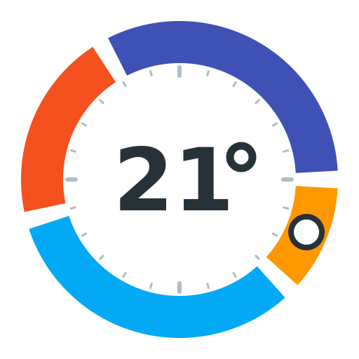
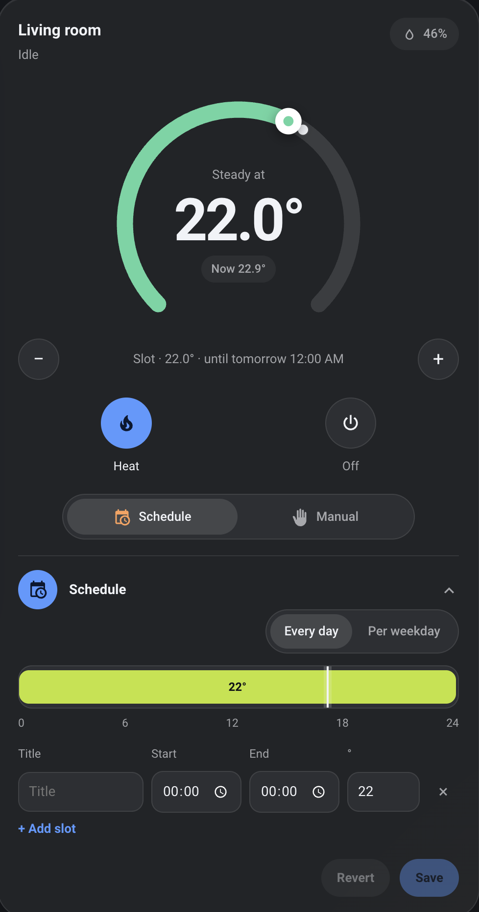
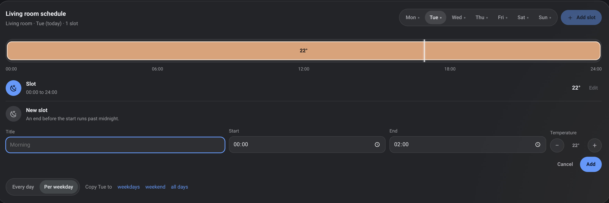

<p align="center"></p>

# Slot Thermostat
[](https://github.com/iamBiB/ha-slot-thermostat/releases/latest)

A Home Assistant thermostat that follows a schedule of **named time slots**, controls **heating, cooling or both**, and lets several rooms share one boiler or AC. It comes with three cards: one for the thermostat, one for its schedule on a timeline, and one for a shared boiler.

| Title        | Start | End   | Temp   |
|--------------|-------|-------|--------|
| Leaving home | 07:00 | 10:00 | 21°    |
| Returning    | 10:00 | 17:00 | 22.5°  |
| Evening      | 17:00 | 23:00 | 22°    |

Outside the slots the thermostat does nothing, so heating and cooling stay off.

| Slot Thermostat card | Slot Schedule card | Slot Heater card |
|---|---|---|
|  |  |  |

## Support
Hey dude! If you like it .. well :beers: or a :coffee: would be nice :D

Questions, ideas or bugs? Join the [discussion on the Home Assistant community forum](https://community.home-assistant.io/t/github-iambib-ha-slot-thermostat-home-assistant-thermostat-with-named-time-slot/1034188) or open a [GitHub issue](https://github.com/iamBiB/ha-slot-thermostat/issues).

[](https://www.buymeacoffee.com/fhc0C7A)

## Features
- **Named slots.** Each slot has a title, start, end and temperature. Use one schedule for every day, or one per weekday, with "copy Monday to weekdays / weekend / all days".
- **Heating, cooling or both.** Control heating switches (boiler relay, zone valve), cooling switches and AC units, in any mix.
- **Several rooms, one boiler or AC.** The shared device runs while **any** room needs it. A room reaching its temperature never stops the others.
- **Margins you set** for when heating or cooling starts and stops, plus a **minimum on/off time** to protect boilers and compressors.
- **Several sensors** per room, averaged. **Window sensors** pause heating and cooling.
- **Temporary overrides.** Changing the temperature holds until the next slot, then the schedule takes over again.
- **Boiler protection:** a maximum run time with a rest, keep-alive re-sends, an automatic turn-off when it runs with no room asking, and run statistics.
- **Safe by default.** Nothing runs with no slot, no temperature reading or an open window. Everything the thermostats were running is turned off when Home Assistant shuts down.
- **Three cards included.** A thermostat card with a dial, round mode buttons and info chips (humidity and more); a schedule card with the day on a timeline, where slots are added and edited in place; and a card for the shared boiler. They take their colours from your theme.

---

<!-- ha-marketplace:exclude-start -->
## 1. Install
Requires Home Assistant 2026.11 or newer (with the Marketplace).

### Marketplace
1. Go to **Settings → Marketplace**.
2. In the upper-right corner, select **Add from link**.
3. Under **GitHub link**, enter `iamBiB/ha-slot-thermostat` and select **Add**. The first time you add a repository by link, Marketplace asks you to connect GitHub: select **Continue** and enter the code shown on GitHub.
4. Open **Slot Thermostat**, select **Install**, check the version, and select **Install** again.
5. Continue with section 2. You can add your first thermostat right away; there's no restart needed after the first install.

**Updates** appear under **Settings → Updates**. After installing one, restart Home Assistant; a repair under **Settings → System → Repairs** reminds you and can do it.

### Manual
1. Copy `custom_components/slot_thermostat` from the latest release into `config/custom_components/`.
2. **Restart Home Assistant.**

All three cards are part of the integration and load automatically. There's no dashboard resource to add.

---
<!-- ha-marketplace:exclude-end -->

## 2. Set up a thermostat
Repeat this for every room or zone.

1. Go to **Settings → Devices & services → Add integration**.
2. Search for **Slot Thermostat** and select it.
3. Choose **Thermostat (a room or zone)**.
4. Fill in the form:
   - **Name:** for example `Living room`. The entity becomes `climate.living_room`.
   - **Temperature sensors:** one or more sensors in the room. Their average is used.
   - **Pick at least one device to control:**
     - **Heating switches:** a boiler relay, zone valve or similar.
     - **Cooling switches:** a fan or cooler relay.
     - **AC / climate devices:** an AC or heat pump. It's set to heat or cool with your target temperature.
   - **Window / door sensors** *(optional)*: heating and cooling pause while any is open.
   - **Start margin / Stop margin:** default 0.3°. Heating starts at *target − start margin* and stops at *target + stop margin*; cooling is the mirror image.
   - **Heat/Cool gap:** default 2°. Only used in Heat/Cool mode, where cooling aims for *target + gap*.
   - **Minimum on/off time:** default 5 min.
   - **Lowest / highest temperature** and **Temperature step.**
5. Select **Submit**. The thermostat starts in **Heat** (or **Cool** if it can only cool) with the **Schedule** preset and an empty schedule, so it does nothing yet.

Change any of these later under **Configure** on the thermostat (**Devices & tuning**).

## 3. Add the thermostat card
The card comes with the integration, so there's no dashboard resource to add. Right after installing, refresh your browser (Ctrl/Cmd+Shift+R) once so it loads.

1. Open a dashboard and select **Edit dashboard → Add card**.
2. Search for **Slot Thermostat** and select it.
3. Pick your thermostat entity and select **Save**.

Or in YAML:
```yaml
type: custom:slot-thermostat-card
entity: climate.living_room
```

The card shows:
- **The header:** the thermostat's name and what it's doing (Heating, Idle…), with info chips on the right (the room's humidity by default).
- **The dial:** drag the knob (only the knob, so scrolling past the card on a phone is safe) or use the arrow keys. The centre shows *Heating to 22.0°* and a *Now 20.8°* chip; the small dot on the arc is the current temperature. The arc is orange while heating, blue while cooling and green when steady. A drag sends one change when you let go.
- **− and +** with the status between them, for example *Leaving home · 21° · until 10:00*, or *Override 23° · until 14:00 · Back to schedule*. The buttons send after a short pause, so several taps make one change.
- **The modes:** a round button each for Heat / Cool / Heat-Cool / Off. Only the modes your devices support appear.
- **Schedule | Manual:** where the target comes from.
- **Schedule row:** **Schedule · 3 slots today**. Tap it to open the schedule right inside the card: the same timeline and slot list as the Slot Schedule card (section 4).

Card options:
```yaml
type: custom:slot-thermostat-card
entity: climate.living_room
name: Living room       # optional
schedule_open: false    # optional, true shows the schedule open
show_schedule: true     # optional, false hides the schedule row entirely
dial: true              # optional, false shows the temperatures as text instead of the dial
info_icons:             # optional, chips in the top-right corner
  - entity: sensor.living_room_humidity
    icon: mdi:water-outline
  - entity: sensor.living_room_co2
    icon: mdi:molecule-co2
```

**Info chips:** each entry in `info_icons` shows that entity's value (with its unit) in the top-right corner; `icon` is optional and otherwise follows the sensor's type. Tapping a chip opens the entity. Without `info_icons` the card shows the room's humidity by itself: the thermostat's own humidity if it has one, otherwise the humidity sensor on the same device as one of its temperature sensors, otherwise one in the thermostat's area. `info_icons: []` shows no chips.

The card takes its colours from your theme, so it fits any theme; with the Atrium theme it matches the rest of an Atrium dashboard.

## 4. Build the schedule

### In the cards
The schedule opens from the **Schedule** row of the thermostat card, or add the **Slot Schedule** card on its own (search for it under **Add card**):

```yaml
type: custom:slot-schedule-card
entity: climate.living_room
title: Schedule          # optional
show_list: true          # optional, false shows only the timeline
```

It shows the day as a timeline: a block per slot, coloured from cool to warm by its temperature, a line for now, and the hours below. Underneath, the slots as a list, with the current one highlighted.

1. Choose **Every day** or **Per weekday** at the bottom. The first switch to per weekday copies the daily slots to every day.
2. *(Per weekday)* Pick a day at the top. A dot marks the days that have slots.
3. Select **Add slot**. It starts where the last slot ends.
4. Fill in **Title**, **Start**, **End** and the temperature (− / +), then select **Add**.
   - An end time earlier than the start runs past midnight and is marked **(+1)**.
   - An end of 23:59 means "until midnight".
5. To change a slot, select **Edit** (or tap its block on the timeline). **Delete** removes it.
6. *(Per weekday)* Use **Copy Mon to weekdays · weekend · all days** to reuse a day.

Every change is saved right away. Overlapping slots and temperatures outside the thermostat's range are refused with a message, and nothing is saved. The card takes its colours from your theme, so it fits any theme; with the Atrium theme it matches the rest of an Atrium dashboard.

### In the settings
1. Go to **Settings → Devices & services → Slot Thermostat** and select **Configure** on the thermostat.
2. Choose **Schedule**.
3. Choose **Every day** or **Per weekday** and select **Next**.
4. You'll see a table (Title | Start | End | Temp) with **Add slot**, **Edit a slot**, **Remove a slot** and **Save schedule**.
   - Per weekday shows the days with their slot counts first, plus **Copy a day to other days…**.
5. Add or edit slots; each opens a small form. Overlaps are rejected right there.
6. Select **Save schedule**. Nothing is applied before that.

The cards and the settings edit the same schedule.

---

## 5. Several rooms, one boiler (or AC)
Use this when several thermostats drive the same switch or AC, for example one boiler heating several rooms.

1. **Create a thermostat for each room** (section 2), and give every room the **same heating switch**, e.g. `switch.boiler`. For a shared AC, give every room the same AC under *AC / climate devices*.
   - That alone is enough: the boiler runs while any room needs heat, and a room reaching its temperature only withdraws its own request.
2. **Add the boiler as a Shared device** for protection and statistics:
   1. Go to **Settings → Devices & services → Add integration → Slot Thermostat**.
   2. Choose **Shared device (boiler, heat pump or AC used by several thermostats)**.
   3. Fill in the form:
      - **Name:** for example `Boiler`. This gives you `sensor.boiler_status`.
      - **Device:** the same switch or AC the rooms use.
      - **Re-send ON every:** *(switches only)* for relays with their own auto-off timer. 0 = off.
      - **Maximum run time:** default 120 min, then a **Rest** (default 10 min). 0 = no limit.
      - **Turn off when running with no request:** default on. It turns the device off 2 minutes after it was switched on with no room asking. Turn this off if you also use the device by hand.
      - **Show notifications:** for the maximum run time and for turn-offs.
   4. Select **Submit**.
3. **Add the Slot Heater card** (section 6).

**Shared AC: first request wins.**
- The AC keeps heating (or cooling) while any room still wants that, then switches over if another room is waiting for the other direction.
- Heating uses the highest requested temperature and cooling the lowest.
- A waiting room shows why, e.g. *waiting: Ducted AC is heating for Living*.

Thermostats only turn off what they started, so a device you switch on by hand isn't overridden, unless the Shared device's "turn off when running with no request" option is on.

## 6. Add the Slot Heater card
1. Open a dashboard and select **Edit dashboard → Add card**.
2. Search for **Slot Heater** and select it.
3. Pick the Shared device's status sensor (e.g. `sensor.boiler_status`) and select **Save**.

Or in YAML:
```yaml
type: custom:slot-heater-card
entity: sensor.boiler_status
name: Boiler            # optional
```

It shows an animated flame (or a snowflake when cooling) with text such as:
- *Heating for 1 h 12 m · Requested by Girlies, Living*
- *Cooling for 40 m · Requested by Bedroom · waiting: Living*
- *Heated for 25 m · 14:05–14:30 · started by Living*
- *Resting · Maximum run time reached · until 14:40*

Tap it for the sensor's details and history.

---

## Reference

### Modes and presets
The **mode** picks the direction:

| Mode | Behaviour |
|---|---|
| Heat | Heats to the target. |
| Cool | Cools to the target. Use this with a summer schedule. |
| Heat/Cool | Heats below the target and cools above *target + gap*. |
| Off | Everything off. |

The **preset** picks where the target comes from:
- **Schedule:** the active slot. Changing the temperature is an override that lasts until the next slot starts or ends.
- **Manual:** one fixed temperature until you switch back.

Changing the temperature, mode or preset yourself takes effect at once: lowering the target below the room temperature stops heating immediately. When the thermostat runs on its own, the margins and the minimum on/off time apply.

### Actions
| Action | Data |
|---|---|
| `slot_thermostat.set_schedule` | `schedule` (see below). Replaces the schedule and clears any override. |
| `slot_thermostat.clear_override` | Back to the schedule. |
| `climate.set_hvac_mode`, `climate.set_preset_mode`, `climate.set_temperature`, `climate.turn_on` / `turn_off` | As for any thermostat. |

```yaml
action: slot_thermostat.set_schedule
target:
  entity_id: climate.living_room
data:
  schedule:
    mode: weekly            # or daily
    daily: []               # used in daily mode
    weekly:
      mon:
        - { title: Leaving home, start: "07:00", end: "10:00", temp: 21 }
        - { title: Returning,    start: "10:00", end: "17:00", temp: 22.5 }
      sat:
        - { title: Weekend, start: "08:00", end: "24:00", temp: 22 }
```
Times are `HH:MM`; seconds are ignored. `24:00` (or `23:59`) means "until midnight".

### Thermostat attributes
- `status`: one readable line, e.g. *Leaving home · 21° · until 10:00*, *No slot · Returning 22.5° at 17:00* or *Manual · 22°*
- `active_slot`, `slot_temperature`, `slot_start`, `slot_end`
- `next_slot`, `next_slot_start`, `next_change`
- `override_temperature`, `override_until`, `manual_temperature`
- `cool_above` (in Heat/Cool mode), `window_open`, `sensors_available` (e.g. `2/2`), `temperature_sensors`
- `reason` (why it is or isn't heating or cooling)

### Shared device sensor
`sensor.<name>_status`: `heating`, `cooling`, `running`, `resting` or `off`. Its attributes:
- `requested_by`, `waiting`
- `running_since`, `started_by`
- `last_run_seconds`, `last_direction`, `last_started_by`, `last_on`, `last_off`
- `resting_until`

### Using other cards
The thermostat is a normal `climate` entity with the presets `schedule` and `manual`. Example with Bubble Card, where the −/+ control only shows in Manual:
```yaml
type: custom:bubble-card
card_type: climate
entity: climate.living_room
show_attribute: true
attribute: status
sub_button:
  - name: Mode
    select_attribute: hvac_modes
  - name: Schedule / Manual
    select_attribute: preset_modes
styles: |
  .bubble-temperature-container,
  .bubble-target-temperature-container {
    ${hass.states['climate.living_room'].attributes.preset_mode === 'manual' ? '' : 'display: none !important;'}
  }
```

## Development
```bash
pip install -r requirements_test.txt && pytest      # integration tests
npm install && npm test                             # card tests (jsdom)
```

## License
MIT
